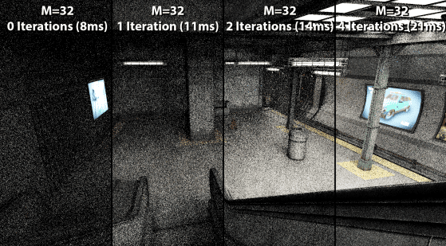
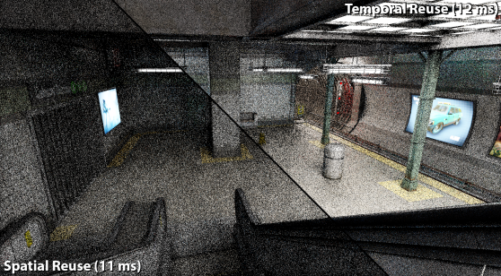

啊嗯，终于开始写 ReSTIR DI 这篇 Paper Reading Blog 了，我是在十月份月初的时候决定学习 ReSTIR 的，在国庆节期间我大概看完了 ReSTIR DI [Bitterli et al. 2020][^1] 这篇论文，但是由于数学部分确实看起来不那么容易就打算搁置一段时间，可是这一放就放了两周左右，这期间去忙着开发新游戏引擎 [Vulcal Engine](https://github.com/Virtual-Graphics/VulcalEngine) ，不过最近在上面遇到了一些挫折打算回来继续完成 ReSTIR DI 的学习。目前只看完了 ReSTIR DI [Bitterli et al. 2020][^1] 而我认为我应该看完 ReSTIR GI [Ouyang et al. 2021][^3] 和 GRIS [Lin et al. 2022][^2] 才有资格写这篇文章，但是我打算不那么做，我打算边写边看。当然这篇文章只代表 Artichoke 个人对论文的理解。让我们开始吧 >_^

## Abstract 
### Spatiotemporal reservoir resampling for real-time ray tracing with dynamic direct lighting
使用 Monte Carlo 积分高效渲染来自数百万动态光源的直接光照即使在离线渲染中也是一个极具挑战性的问题。这篇论文介绍了一种新的算法：ReSTIR ，这个算法能在保证可交互性的前提下，高质量的渲染此类光照，并且不需要维护复杂的数据结构。该算法反复对一组候选光照样本进行重采样，并进一步应用空间和时间重采样，以利用来自邻近样本的相关信息。 Bitterli et al. 还给出了这个方法的无偏 Monte Carlo 估计量，并证明了比之前最先进的方法在相同误差下块 6-60 倍，除此之外他们的有偏估计量能更进一步减少噪声，比之前最先进的方法在相同误差下块 35-65 倍，但代价是在几何不连续处出现部分能量损失。他们在 GPU 上实现了该方法，每帧渲染包含多达 340 万个动态发光三角形的复杂场景，同时每个像素最多追踪 8 条射线，耗时不到 50 毫秒。

### This Blog
在这篇 Paper Reading Blog 中，将在 Section 1 中介绍在 ReSTIR DI 之前实时光线追踪的一些问题，以及 ReSTIR DI 的大致解决方案，接着在 Section 2 中回顾一下 ReSTIR DI 需要使用的数学前提，然后在 Section 3 中介绍 ReSTIR DI 的具体做法，最后在 Section 4 中介绍 ReSTIR DI 的有偏性，并推导出无偏估计量，~如果有机会写 Section 5 的话我非常乐意使用 [Vulcao](https://github.com/Yang-Junjie/vulcao) 写一个 ReSTIR DI 的 Demo~ .

## 1. INTRODUCTION
随着 NVIDIA 在 2018 年发布了支持硬件光追的显卡后，基于 Monte Carlo 的光线追踪方法逐渐应用在实时渲染领域。我们知道传统 Path Tracing 方法中，我们会从像素出发发出很多条Primary Ray，这些 Primary Ray 第一次击中物体后，根据 BSDF 采样产生 Secondary Ray，在场景中不断反弹，在每个反弹点，除了继续采样下一条路径光线外，通常还会用 NEE[^4][^5] 直接向光源连接一条 Shadow Ray 来估计直接光照，若 BSDF 采样在后续存活并且击中光源，则用 MIS[^6][^7] 融合两条途径的贡献，其贡献累加回最初对应的像素。即使是在离线渲染中，使用传统 Path Tracing 方法去渲染具有大量发光物体的直接光照的场景仍然充满挑战。在实时领域那就更加困难重重了，在实时场景中渲染器通常不知道场景将会发生什么变化，通常这种变化来自用户的交互。此外由于实时的时间限制，每个像素通常只能追踪极少数光线。而如果场景中存在数百万动态光源那么朴素 NEE 方法将难以在有限的时间中完成渲染，因此寻找重要光源变得更为关键，有某些方法可以提供辅助光照采样的数据结构，而这些数据结构的构建和更新需要花费大量的时间。  

论文介绍了一种从众多光源中采样单次反弹直接光照的方法，此方法适用于具有完全动态场景的实时光线追踪。该方法建立在 Resampling Importance Sampling [Talbot 2005][^8] 的基础上，对于 Resampling Importance Sampling 的简单介绍可以看 [Artichoke 2026][^9] 对 Reading Importance Resampling for Global Illumination 的 Paper Reading ，此外该方法还使用了一个小型的固定大小的名为 Reservoir 数据结构，它存储了 RIS 接受的样本，此外它还是一个抽样算法/采样算法，通常应用在非图形学领域，对于 Reservoir Sampling 的简单介绍可以看 [Artichoke 2026][^10] 的 Reservoir Sampling 这篇 Blog.

在拥有 Reservoir 的前提下，该方法不使用任何比固定大小数组更复杂的数据结构，它通过复用来自时间和空间相邻像素的统计信息，以随机、渐进和分层的方式改善了每个像素的直接光照采样 PDF 。与现代实时降噪算法在时间和空间邻域内复用像素颜色不同，该方法可以复用渲染器中使用的采样概率信息，这反过来使得无偏算法成为可能。该方法的无偏模式可以修改为有偏模式，这进一步降低了噪点，代价是在几何不连续处会出现一些过度变暗的现象。

我们将在 Section 2 中回顾一下 ReSTIR DI 需要的数学知识和算法以便更好的学习 ReSTIR DI.

## 2. PRELIMINARIES
在某个 Shading Point $y$ 处沿出射方向 $\vec{\omega}_o$ ，由 Direct Light（直接光）产生的 Radiance（辐射度）$L$，由所有自发光表面 $A$ 的积分给出：
$$
\begin{equation}

L(y,\vec{\omega}_o) = \int_{A} \rho(y,\vec{yx}\leftrightarrow\vec{\omega}_o) L_e(x \to y) G(x \leftrightarrow y) V(x \leftrightarrow y) \mathrm{d}A_x
\end{equation}
$$
其中 $\rho$ 为 $y$ 处的 BSDF（双向散射分布函数）， $L_e$ 为光源的自身发射出来的 Radiance，几何项 $G$ 包含距离平方反比项和余弦项，$V$ 为 $x$ 和 $y$ 之间的可见性函数。也许你可以看看 [Artichoke 2026][^11] 的 Re0-PT 对 $eq:(1)$ 的介绍，不过都是几个月前的了，现在看起来 Re0-PT 存在很多不正确的地方。

为了简单起见我们将微分面积记为 $\mathrm{d}x$ 并忽视各种方向，设我们的积分为：
$$
\begin{equation}
L = \int_{A}f(x)\mathrm{x},\quad \text{where} \quad f(x) \equiv \rho(x)L_e(x)G(x)V(x)
\end{equation}
$$
### 2.1 Importance Smapling (IS)
我们为了求该复杂积分的值，我们使用标准的 Monte Carlo importance sampling estimator:
$$
\begin{equation}
\langle L \rangle_{\text{is}}^{N} = \frac{1}{N} \sum_{i=1}^{N} \frac{f(x_i)}{p(x_i)} \approx L
\end{equation}
$$
表示从 PDF （概率密度函数） $p$ 中采样 $N$ 个样本 $x_i$，再将样本 $x_i$ 带入此公式（IS 估计量）来估算积分 $L$，importance sampling 当 $f(x)$ 不等于 $0$ 时，且 $p(x)$ 大于 $0$ 则 IS 估计量保证 unbiased（无偏），当 $p(x)$ 与 $f(x)$ 相关（可以理解为函数形状类似）时可以降低方差，相关程度越高，方差越小，当 $p(x) \equiv f(x)$ 时方差为 $0$ ，但这是不可能的因为如果我们知道了 $p(x)$ 就没必要进行计算了。

### 2.2 Multiple Importance Sampling (MIS)
在实践中通常我们有多种采样策略，例如对 BSDF 采样与对光源的采样 (NEE)，而我们需要通过 Multiple Importance Sampling (MIS) [Veach and
Guibas 1995b][^7] 将不同的策论的采样组合起来，标准的 MIS estimator:
$$
\begin{equation}
\langle L \rangle_{\text{mis}}^{M,N} = \sum_{s=1}^{M} \frac{1}{N_s} \sum_{i=1}^{N_s} w_s(x_i) \frac{f(x_i)}{p_s(x_i)}
\end{equation}
$$
表示给定 $M$ 个采样策略 s 以及对应的 pdf $p_s$，MIS [Veach and Guibas 1995b][^7] 在每种策略 s 中抽取 $N_s$ 个样本，并使用合适的权重 $w_s(x_i)$ 将它们组合成一个加权估计量。只要 $\sum_{s=1}^{M} w_s(x) = 1 $，则 MIS 就是 unbiased 。有关 MIS 可以看看 [Artichoke 2026][^13] 在 Re0-PT 的简单介绍 ~由于写的的确不是很好，Artichoke 都不太敢在这里引用，你们还是看 Vench 的原论文或者去互联网上看看更好的文章~ 。  

### 2.3 Resampled Importance Sampling (RIS)
Resampled Importance Sampling (RIS) [Talbot 2005][^8] 是一种与 MIS 不同的方法，可以看 [Artichoke 2026][^12] 关于 RIS 的简单介绍。RIS 先从一个简单的 pdf/源分布 $p$ 中生产 $M \ge 1$ 个候选样本 $\mathbf{x} = \{ x_1,x_2,\dots,x_M \}$，该 pdf ($p$) 与 $f(x)$ 的相关性较差，但是非常易于采样，随后我们为这 $M$ 个候选样本附加对应的权重 $\mathbf{w}(x)$，然后依据每个样本的权重计算每个样本的归一化概率 $p(z \mid \mathbf{x})$，然后根据这些离散的归一化概率随机选择一个索引 $z \in \{1, \dots, M\}$ 该索引对应候选样本池中的样本就是最终抽取到的样本。  

$$
\begin{equation}
p(z \mid \mathbf{x}) = \frac{\mathbf{w}(x_z)}{\sum_{i=1}^{M} \mathbf{w}(x_i)} \quad \text{where} \quad \mathbf{w}(x) = \frac{\hat{p}(x)}{p(x)}
\end{equation}
$$

其中 $\hat{p}(x)$ 是目标 pdf ，即那个在文章一开始我们提到的 pdf，通常该目标分布 $\hat{p}(x)$ 相比源分布 $p(x)$ 复杂，不好被采样，没有实际的采样算法，我们设 $y = x_z$ 表示最终被选在候选样本池中被选中的样本，则采样单个样本的 RIS estimator:  

$$
\begin{equation}
\langle L \rangle_{\text{ris}}^{1,M} = \frac{f(y)}{\hat{p}(y)} \cdot \left( \frac{1}{M} \sum_{j=1}^{M} \mathbf{w}(x_j) \right)
\end{equation}
$$

如果我们采样 $N$ 个样本，则需要将单个样本的 RIS estimator 累加起来并做平均：  

$$
\begin{equation}
\langle L \rangle_{\text{ris}}^{N,M} = \frac{1}{N} \sum_{i=1}^{N} \left( \frac{f(y_i)}{\hat{p}(y_i)} \cdot \left( \frac{1}{M} \sum_{j=1}^{M} \mathbf{w}(x_{ij}) \right) \right)
\end{equation}
$$

当 $M,N \ge 1$ 且 当$f(x)$ 不等于 $0$ 时 $p(x),\hat{p}(x)$ 大于 $0$ 则 RIS 估计量保证 unbiased. 接下来我们为了简单起见假设 $N = 1$，即使用 $eq:(6)$，如果要采样 $N > 1$ 个 样本我们只需要对单次的估计量循环 $N$ 次并累加起来，最后做平均就好了。  

通常对于不同的像素 $q$ 其对应的被积函数 $f(x)$ 和对应的目标 PDF $\hat{p}(x)$ 也不同，为了区分我们使用 $f_q(x)$ 和 $\hat{p}_q(x)$ 表示某个像素 $q$ 所对应的被积函数和目标 PDF. 我们在算法 1 中展示了 $N = 1$ 时 RIS 的 Python 代码。  

```python
# 算法 1: Resampled Importance Sampling (RIS)
import random
import bisect

def sample_pdf(x): 
    # 对应 p(x)
    pass

def eval_target_pdf(x): 
    # 对应 \hat{p}(x)
    pass

def eval_function_f(x): 
    # 对应 f(x)
    pass

def ris_estimator(M, target_pdf_func, source_pdf_func, f_func):
    """
    M: 候选样本数量
    返回: (样本 y, 权重和 W_sum)
    """
    candidates_x = []
    weights_w = []
    W_sum = 0.0
    
    # 生成候选样本
    for _ in range(M):
        # 从源分布 p 生成 x_i
        xi = source_pdf_func() # 需要实现具体的采样逻辑
        candidates_x.append(xi)
        
        # 计算权重 w_i = \hat{p}(x_i) / p(x_i)
        p_hat_val = target_pdf_func(xi)
        p_val = sample_pdf(xi)
        wi = p_hat_val / p_val
        
        weights_w.append(wi)
        # 累加权重和
        W_sum += wi

    # 根据权重构建 CDF 并随机选择索引
    # Python 中可以使用 random.choices 实现加权随机选择
    # 这里模拟 CDF 过程
    cdf = []
    current_sum = 0.0
    for w in weights_w:
        current_sum += w
        cdf.append(current_sum)
    
    # 使用二分查找找到对应的索引，其实可以使用 random.choices 实现加权随机选择，但是原论文中第 12 行是手动构建 CDF 
    r = random.uniform(0, W_sum)
    index = bisect.bisect_left(cdf, r)
    
    # 防止索引越界（因为浮点误差）
    if index >= len(candidates_x):
        index = len(candidates_x) - 1
        
    y = candidates_x[index]

    return y, W_sum

# 使用示例 :
# y, W_sum = ris_estimator(M, ...)
# M_reciprocal = 1.0 / M
# estimator_value = (f(y) / target_pdf(y)) * (M_reciprocal * W_sum) # eq : (6)
```

上面我们提到的 RIS 假设了单一的源PDF $p$，但是在实际中通常我们有多种采样策略，这需要 RIS 与 MIS 进行结合。幸运的是 [Talbot 2005][^8] 展示了如何进行这种操作。不幸的是，这种形式的 MIS 的成本太高。而此论文给出了一种通过空间和时间重用，使用不同的源 PDF 和积分域来大幅增加候选样本数量的方式使用 RIS。  

由于传统的 RIS 要求样本是 i.i.d. （独立同分布）的，即每个像素中的每条光线，在物体表面挑选采样点时是各自独立生成的；并且对于某一条光线，所有被采样出来的候选样本都是由同一个 PDF 抽样出来的。而在后续 Section 3 中我们会详细介绍 ReSTIR DI 的做法，而其中的 时空复用 会打破 RIS 要求的 i.i.d. 导致最终的估计量是 biased 的，在 Section 4 我们我们会分析其 biased 并给出 unbiased 的估计量，而更规范更标准的无偏的应用于 ReSTIR 的 RIS 在 GRIS (Generalized Resampled Importance Sampling) [Lin et al. 2022][^2] 论文中给出，GRIS 是建立坚实的 ReSTIR 的数学基础，将传统的 RIS 理论进行了推广，允许在不同分布的、相关的样本之间进行重采样。但这不在本文的讨论范围内。  

### 2.4 Weighted Reservoir Sampling (WRS)
Weighted reservoir sampling 是一类算法，有关 WRS 的简单介绍可以看看 [Artichoke 2026][^14] 的简单介绍。WRS 是一种采样算法，若给定数量未知或数量极其庞大的样本 $\{ x_1,x_2,x_3, \dots \}$ ，并且每个样本都有一个对应的权重 $\mathbf{w}(x_i)$，WRS 能保证每个元素被抽中的概率与其权重成正比。WRS 会使用一个名为 Reservoir 的容器，将一些候选样本暂时存放在这个容器中，这个容器的作用非常符合它的名字 “蓄水池”，在 ReSTIR 中我们只需要大小为 $1$ 的 Reservoir，那么某个样本 $x_i$ 被选中的概率就是：  

$$
\begin{equation}
P_i = \frac{w(x_i)}{\sum_{j=1}^{M} w(x_j)}
\end{equation}
$$

Reservoir Sampling 对每个元素仅处理一次，它是一种流式算法，数据流的长度 $M$ 无需预先知晓，所以可以处理数量未知或数量极其庞大的样本。ReSTIR DI 中使用的是由 [Chao. 1982][^13] 给出的 WRS 算法。具体的算法步骤可以看 TDSG 中 [Artichoke 2026][^14] 对此的简单介绍，或者看原论文 [Bitterli et al. 2020][^1].
我们在算法 2 中展示了基于 [Chao. 1982][^13] 的 WRS Python 代码。  

```python
# 算法 2: Weighted Reservoir Sampling (WRS)
import random

class Reservoir:
    def __init__(self):
        self.y = None       # 输出样本
        self.W_sum = 0.0    # 权重和
        self.M = 0          # 目前已遍历过的样本数

    def update(self, xi, wi):
        """
        更新蓄水池
        xi: 当前样本
        wi: 当前样本的权重
        """
        self.W_sum += wi
        self.M += 1
        
        # 以概率 (wi / W_sum) 替换当前样本
        if random.random() < (wi / self.W_sum):
            self.y = xi

def reservoir_sampling(stream_samples, stream_weights):
    """
    对数据流进行 WRS
    stream_samples: 样本列表/生成器
    stream_weights: 对应的权重列表/生成器
    """
    r = Reservoir()
    
    # 遍历所有样本并更新
    for xi, wi in zip(stream_samples, stream_weights):
        r.update(xi, wi)
        
    # 返回 Reservoir
    return r
```

## 3 ReSTIR DI (STREAMING RIS WITH SPATIOTEMPORAL REUSE)
在本节中我们将正式开始介绍 ReSTIR DI ，我们会先在 3.1 中介绍将 RIS 与 WRS 结合的后的流式算法，随后我们会在 3.2 节介绍如何合并多个 Reservoir 这是 ReSTIR 时空重用的基础，在 3.3 节我们介绍完整的 ReSITR DI 算法。不幸的是，依照现有的朴素方法是 biased 的，就像我们上文说的，由于时空重用打破了 RIS 的 i.i.d. 邻居样本或上一帧样本的 BSDF 不同打破了同分布，并且样本依赖于其他样本打破了独立性。这导致结果图在几何不连续处的能量损失。在后续的 Section 4 中我们会给出 unbiased 简单的推导。  

### 3.1 Streaming RIS using reservoir sampling
原论文并没有给出具体将两个算法 (RIS & WRS) 结合的具体过程，直接给出了算法，我们先给出 算法 3 的 python 实现，后让 Artichoke 尝试解释一下。  
``` python
# 算法 3：Streaming RIS using reservoir sampling
import random

# 假设以下函数已定义，用于获取 PDF 和被积函数
def sample_source_pdf(): 
    # 从源分布 p 中生成样本 xi
    pass

def eval_target_pdf_q(xi, q): 
    # 计算 \hat{p}_q(xi)
    pass

def eval_source_pdf(xi): 
    # 计算 p(xi)
    pass

def eval_function_fq(xi, q): 
    # 计算 f_q(xi)
    pass

def RIS(q, M):
    r = Reservoir()

    for i in range(M):
        # 生成候选样本 xi ~ p
        xi = sample_source_pdf()
        
        # 更新 Reservoir
        weight = eval_target_pdf_q(xi, q) / eval_source_pdf(xi)
        r.update(xi, weight) # 算法 2
        
    p_hat_y = eval_target_pdf_q(r.y, q)
    r.W = (1.0 / p_hat_y) * ((1.0 / r.M) * r.W_sum) # eq : (6)  
        
    return r

def shadePixel(r, q):
    return eval_function_fq(r.y, q) * r.W

def render_image(image_pixels):
    M = 32 # 假设每个像素生成 32 个候选样本

    for q in image_pixels:
        image_pixels[q] = shadePixel(RIS(q, M), q)
        
    return image_pixels
``` 
RIS 的步骤是依照源 PDF $p$ 采样 $M$ 候选个样本 $x_i$，并为每个样本 $x_i$ 赋予权重 $\mathbf{w}(x_i) = \frac{\hat{p}(x_i)}{p(x_i)}$，在依照权重对这些候选样本进行重采样，但是重采样的方法并没有规定，所以我们可以用 WRS 对这 $M$ 个候选样本进行重采样。就这样 RIS 和 WRS 简单的结合在了一起。  

### 3.2 Combining the streams of multiple reservoirs
[Bitterli et al. 2020][^1] 注意到，相邻像素的目标 PDF 之间通常存在着显著的相关性，即“长的很像”。那么我们可以使用 Reservoir Sampling 的一个关键特性来利用这像素之间相关性，该特性允许我们在不访问其输入流的情况下合并多个 Reservoir。一个 Reservoir 的状态包括当前选择的样本 $y$ 以及迄今为止所有候选样本的权重之和 $ \mathbf{w}_{sum}$，那么我们为了合并多个 Reservoir 可以把每个 Reservoir 的 $y$ 视为一个新的样本，它的对应的权重是 $\mathbf{w}_{sum}$ ，将这些 $y$ 组成一个候选样本集，并使用类似 算法 3 的做法，流式处理这些新的由 Reservoir 中样本组成的候选样本。  

需要考虑的是这些新样本的权重 $\mathbf{w}_{sum}$ 并不能直接用于重采样，考虑到来自相邻像素 $q^{\prime}$ 的样本是服从于与像素 $q$ 样本不同的目标分布 $\hat{p}_{q^{\prime}}$，根据测度论中的测度变换/重要性权重的修正，我们需要使用 $\frac{\hat{p}_q(r.y)}{\hat{p}_{q^{\prime}}(r.y)}$ 对 $q^{\prime}$ 的权重 $\mathbf{w}_{sum}$ 进行调整，以补偿在相邻像素处相比当前像素被过度或欠采样的区域将样本从邻居像素的目标分布校正到当前像素的目标分布 [Bitterli et al. 2020][^1] 。再乘以新样本的权重 $\mathbf{w}_{sum}$ 可以得到 $\hat{p}_q(r.y) / \hat{p}_{q^{\prime}}(r.y) \cdot r.w_{\text{sum}}$ 为了化简公式我们可以联立 $eq:(6)$ 的一部分 或 算法 3 中的第 33 行 $r.W = \frac{1}{\hat{p}_q(s.y)}(\frac{1}{s.M} \cdot s.\mathbf{w}_{sum})$ 可得最终用于重采样的权重为 $\hat{p}_q(r.y) \cdot r.W \cdot r.M$ [Bitterli et al. 2020][^1] 。我们在 算法 4 中展示了合并 $k$ 个 Reservoir 的 python 代码。  

```python
# 算法 4: Combining the streams of multiple reservoirs
def combine_reservoirs(q, reservoirs_list):
    """
    q: 当前像素
    reservoirs_list: 需要合并的蓄水池列表 [r1, r2, ..., rk]
    """
    # 创建新的蓄水池
    s = Reservoir()
    
    total_M = 0
    target_pdf_func = get_target_pdf_func(q) # 获取当前像素 q 的目标 PDF \hat{p}_q

    # 遍历所有要合并的蓄水池
    for r in reservoirs_list:
        # 计算等效权重并更新新蓄水池
        # 这里的 r.W w_{sum}，r.M 是样本数
        s.update(r.y, target_pdf_func(r.y) * r.W * r.M)
        
        # 累加总样本数
        total_M += r.M

    # 更新新蓄水池的总样本数
    s.M = total_M
    
    # 重新计算新蓄水池的最终 RIS 权重因子
    p_hat_s_y = target_pdf_func(s.y)
    s.W = (1.0 / p_hat_s_y) * ((1.0 / s.M) * s.W_sum)

    # 返回合并后的蓄水池
    return s
```

### 3.3 Spatial Reuse
Reservoir Sampling 的可合并性使得在 RIS 中实现一种实用的计算复用算法成为可能 [Bitterli et al. 2020][^1] 。具体第一步是先使用 RIS 为每个像素 $q$ 生成 $M$ 个候选样本，并将得到的 Reservoir 存放在和图片尺寸一致的 Buffer 中，第二步，我们使用某种方法选择像素 $p$ 周围的 $k$ 个邻居（这些邻居已经被存放在 Buffer）Reservoir 并利用算法 4 将 $k$ 个邻居 Reservoir 合并到像素 $q$ 的 Reservoir 上并再次写入 Buffer。如下图，展示了 [Bitterli et al. 2020][^1] 对 Spatial Reuse 分别进行 0,1,2,4 次的结果。

显而易见的，我们可以对第二步进行多次以得到更好的渲染结果。进行一次的总时间复杂度是 $O(K+M)$ ，进行 $n$ 次的时间复杂度是 $O(nk+M)$ 但每个像素实际上能获得 $k^n \cdot M$ 个候选样本，这得到的提升是非常显著的。但是这种收益并非无限；最终，迭代复用会纳入附近像素的所有候选样本，图像质量便会停止提升 [Bitterli et al. 2020][^1]  。

### 3.4 Temporal Reuse
虽然 ReSTIR 也能用于渲染静态图片，但是主要战场还是在实时动画序列中。在这种情况下图像通常不是孤立的，前一帧可以提供额外的候选样本用于复用。渲染完某一帧后我们可以存储该帧每个像素最终的 Reservoir 以便在下一帧中复用。随着时间的推移，新的一帧不断复用/合并前一帧的样本，最新的一帧不仅仅只是复用了上一帧的样本，因为如果前一帧复用了前前一帧的样本，那么最新一帧则相当于合并序列中所有先前帧的候选样本，这极大地提高了图像质量。下图展示了 [Bitterli et al. 2020][^1] 比较仅 Spatial Reuse 与 spatiotemporal reuse 的效果。



### 3.5 Visibility Reuse
虽然我们看似已经能得到一个很好的结果了是吧，“啊那只要我的 $M$ 足够大，候选样本足够多，重用次数足够多，随着时间的推进，我们是不是能得到一个好的结果？”。不幸的是，在目前即使拥有无限的候选样本，尽管随着 $M$ 趋向于无穷我们也不能得到一个好的结果，样本的分布会逼近我们的目标概率密度函数 $\hat{p}$ ，但是在实践中，通常 $\hat{p}$ 被选择为一个不能完美地采样 $f(x)$ 的 PDF（通常我们会将 $\hat{p}$  设置成 $\rho(x)L_e(x)G(x)$），这是由于 Visibility 项导致的。这意味随着 $M$ 增大由 $V$ 项导致的噪声无法被处理。  

为了解决这个问题 [Bitterli et al. 2020][^1] 使用了 Visibility Reuse （可见性复用）在进行空间或时间复用之前，我们会判断每个像素 Reservoir 中所选样本 y 的可见性。如果 y 被遮挡，我们就丢弃该 Reservoir 。这意味着被遮挡的样本不会传播到相邻像素，并且如果可见性在局部是连贯的，那么通过空间重采样产生的最终样本很可能不会被遮挡。

### 3.6 Complete ReSTIR DI Algorithm
算法 5 给出了完整的 Reservoir python 代码。

```python

# 算法 5: ReSTIR DI with Spatiotemporal Reuse

def reservoir_reuse(prev_frame_reservoirs, image_pixels, n):
    """
    prev_frame_reservoirs: 上一帧的 Reservoir Buffer
    image_pixels: 当前帧所有像素
    n: Spatial Reuse 的迭代次数

    返回: 当前帧的 Reservoir Buffer
    """

    # 创建当前帧的 Reservoir Buffer
    reservoirs = {}

    # Generate initial candidates
    for q in image_pixels:
        # 为每个像素生成初始 Reservoir
        reservoirs[q] = RIS(q, M=32)  # 算法 3
    
    # Evaluate visibility for initial candidates
    for q in image_pixels:
        r = reservoirs[q]
        # 判断当前选中的样本是否被遮挡
        if r.y is not None and shadowed(q, r.y):
            # 如果被遮挡，则将 Reservoir 权重设为 0
            r.W = 0.0

    # Temporal reuse
    for q in image_pixels:
        # 在上一帧中寻找对应的时间邻居
        q_prime = pick_temporal_neighbor(q)
        if q_prime is None:
            continue
        
        # 合并当前 Reservoir 与上一帧对应像素的 Reservoir
        reservoirs[q] = combine_reservoirs(q,[reservoirs[q],prev_frame_reservoirs[q_prime]])  # 算法 4

    # Spatial reuse
    for iteration in range(n):
        # 保存当前迭代的 Reservoir Buffer
        # 避免同一轮迭代中读取已经更新的 Reservoir
        source_reservoirs = reservoirs
        next_reservoirs = {}

        for q in image_pixels:
            # 选择当前像素周围的空间邻居
            Q = pick_spatial_neighbors(q)
            # 获取邻居像素对应的 Reservoir
            R = [source_reservoirs[q_prime] for q_prime in Q if q_prime in source_reservoirs]
            # 合并当前 Reservoir 和邻居 Reservoir
            next_reservoirs[q] = combine_reservoirs(q,[source_reservoirs[q]] + R)  # 算法 4

        # 更新 Reservoir Buffer
        reservoirs = next_reservoirs
    
    # Compute pixel color
    for q in image_pixels:
        # 根据最终 Reservoir 计算像素颜色
        image_pixels[q] = shadePixel(reservoirs[q], q)  # 算法 3

    return reservoirs

```
[Bitterli et al. 2020][^1]  首先通过 RIS 在 $M$ 个独立的逐像素光照候选样本中生成样本并重采样，之后对这些重采样得到的样本进行可见性测试，被遮挡的样本会被丢弃。然后将每个像素蓄水池中选出的样本与前一帧的输出（通过反投影确定，就是我们常说的 Motion Vector Buffer）进行合并。我们执行 n 轮空间复用，以利用来自像素邻居的信息。最后对图像进行着色，并将最终的蓄水池传递到下一帧。

通常 $M$ 表示每个像素初始生成的光照候选样本数量，它并不等于场景中的光源数量。对于面光源，即使场景只有一个光源，也可以通过在其发光表面上进行多次采样生成多个不同的候选样本。$M$ 通常作为一个可调节的参数，用于平衡初始采样质量与计算开销。

## 4. BIAS IN MULTI-DISTRIBUTION RIS
在上文中我们多次提到过 RIS 在处理来自 Reservoir 复用邻居或历史帧时的像素中的样本会破坏 RIS 的无偏性，这主要是因为不同像素的样本是服从不同目标 PDF 而 RIS 要求所有样本服从同一个 PDF。为了解决这个问题 [Lin et al. 2022][^2] 提出了 广义上的 RIS 算法 (GRIS) 使得 RIS 能够处理来自不同 PDF 的样本，但是在本文中我们不会涉及到 GRIS 中的内容 ~才不是因为 Artichoke 在写这文章的时候还没看，哼哼~ ，所以这节只会覆盖 ReSTIR DI [Bitterli et al. 2020][^1] 中分析 RIS 的 biased 和 unbiased 的数学原理。

我们将会先在 Section 4.1 [分析 RIS 权重](4.1-Analyzing-the-RIS-Weight)，再在 Section 4.2 [讨论 biased RIS](4.2-Biased-RIS)，最后在 Section 4.3 给出 [unbiased RIS](4.3-Unbiased-RIS) 

### 4.1 Analyzing the RIS Weight
为了说明 RIS 中 biased 的来源，我们先把 $eq:(6)$ 整理成下面这个样子：
$$
\begin{equation}
\langle L \rangle_{\text{ris}}^{1,M} = f(y) \cdot \left( \frac{1}{\hat{p}(y)} \frac{1}{M} \sum_{j=1}^{M} w(x_j) \right) = f(y)W(\mathbf{x}, \mathbf{z})
\end{equation}
$$
这么做的原因是便于我们单独对其中的 $W(\mathbf{x}, \mathbf{z})$ 进行分析，$f$ 在我们这里完全不重要，其中 $W(\mathbf{x}, \mathbf{z})$ 是一个随机变量，它的取值或者换句话说它输出的样本 $y$ 取决于样本 $\{ \mathbf{x},\mathbf{z} \}$ 。

还记得 Monte Carlo 的 Importance Sampling 形式吗，如果我们只采样一个样本（当然我们实际上不会这么做，这里只是为了我们便于讨论数学）那么我们能得到如下形式：
$$
\begin{equation}
\langle L \rangle_{\text{is}}^{1} = \frac{f(y)}{p(y)}
\end{equation}
$$
我们对比 $eq:(9)$ 与 $eq:(10)$ 可以发现如果 随机变量 $W$ 的期望等于 $\frac{1}{p(y)}$ 那么我们就能保证公式 $eq:(6)$ 的无偏。在接下来我们将表明现在的 $W$ 并不能保证无偏即其期望并不恒等于 $\frac{1}{p(y)}$ 。


### 4.2 Biased RIS
在标准的 RIS [Talbot 2005][^8] 中所有的样本都是服从同一个概率密度函数的，而在这一小节中我们的主要目标是推导出样本来自不同 PDF 时 RIS 最终生成样本 $y$ 的边缘概率密度函数 (Marginal Probability Density Function) $p(y)$，并求 $W(\mathbf{x}, \mathbf{z})$ 的条件期望即可判断无偏性。对于候选样本集 $\mathbf{x} = \{ x_1, \dots\ x_M\}$ 中的每个样本 $x_i$ 可能来自不同的源 PDF $p_i(x_i)$。由于我们假设了这些样本的独立性，所以我们可以计算这些候选样本的联合概率密度函数 (Joint PDF) $p_{\mathbf{x}}$：
$$
\begin{equation}
p(\mathbf{x}) = \left[ \prod_{i=1}^{M} p_i(x_i) \right]
\end{equation}
$$

在 RIS 的第二步中，我们需要根据样本的 PDF 来计算 $eq:(5)$ 挑选离散索引 $z \in \{1, \dots M \}$，来决定采样的最终样本 $x_z$ 也就是 $y$：
$$
\begin{equation}
p(z \mid \mathbf{x}) = \frac{\mathbf{w_z}(x_z)}{\sum_{i=1}^{M} \mathbf{w_i}(x_i)} \quad \text{where} \quad \mathbf{w}_i(\mathbf{x}) = \frac{\hat{p}(\mathbf{x})}{p_i(\mathbf{x})}
\end{equation}
$$

现在我们有了 $p(\mathbf{x})$ 和 $p(z \mid \mathbf{x})$ 那么我们就能写出 RIS 在第一步恰好生成了特定的一组候选样本集 $\mathbf{x}$ 并且在第二步恰好选中了索引 $z$ 的联合概率密度。
$$
\begin{equation}
p(\mathbf{x}, z) = p(\mathbf{x})p(z \mid \mathbf{x}) = \left[ \prod_{i=1}^{M} p_i(x_i) \right] \frac{w_z(x_z)}{\sum_{i=1}^{M} w_i(x_i)}
\end{equation}
$$
这距离我们得到我们的目标 $p(y)$ 就差最后一步了，即利用 $p(z \mid \mathbf{x})$ 计算边缘概率，我们在本科阶段都学过。不过他的求解方式需要解释一下，对于 $p(y)$ 来说可能会存在多组 $\{ \mathbf{x} ,z \}$ 使得 RIS 返回 $y$。还记得我们在本科阶段求边缘概率密度得情景吗？如果是连续概率密度，我们只会对非零得区域进行积分。而在候选样本集中某些样本并不会对结果产生贡献，也就是"0"，所以根据原论文 [Bitterli et al. 2020][^1] 我们可以定义一个集合 $Z(y)$ 表示所有对 $y$ 有贡献的样本：
$$
\begin{equation}
Z(y) = \{ i \mid 1 \le i \le M \land p_i(y) > 0 \}
\end{equation}
$$

随后我们对 $p(\mathbf{x}, z)$ 求边缘概率密度：
$$
\begin{equation}
p(y) = \sum_{i \in Z(y)} \underbrace{\int \cdots \int}_{M-1 \, \text{times}} p(\mathbf{x}^{i \to y}, i) \, \underbrace{\mathrm{d}x_1 \dots \mathrm{d}x_M}_{M-1 \, \text{times}}
\end{equation}
$$

其中 $\mathbf{x}^{i \to y} = \{x_1, \dots, x_{i-1}, y, x_{i+1}, \dots, x_M\}$，其中第 $i$ 个候选被固定为 $y$ 积分仅对未固定的 $M-1$ 个候选进行。

> 为了让读者不那么疑惑，Artichoke 打算说清楚 $p(z \mid \mathbf{x})$、$p(y)$、$p(\mathbf{x})$、$p(\mathbf{x}, z)$ 分别表示的含义。$p(\mathbf{x})$ 表示的是恰好生成某组候选样本集 $\mathbf{x}$ 的概率密度；$p(z \mid \mathbf{x})$ 表示的是在给定某个候选样本集 $\mathbf{x}$ 的情况下从中抽到 $x_z$ 的离散概率分布；$p(\mathbf{x}, z)$ 表示第一步我们生成 $\mathbf{x}$ 的基础上第二步抽到 $x_z$ 的概率密度；$p(y)$ 表示无论间经历了怎样的过程和路径，最终得到 $y$ 的概率密度；这其中也许有些人忘记了为什么需要使用联合概率密度 $p(\mathbf{x}, z)$ 求边缘概率密度 $p(y)$，这看似很奇怪一个无中间状态无关的量居然是从中间状态中求出来，但如果我们看看他的求解方式，是通过求和积分，也就是把所有的中间状态穷举加起来（全概率公式）是不是就变得没那么困惑了呢。

现在有的我们都有了，我们可以计算 $W(\mathbf{x}, \mathbf{z})$ 的条件期望了。在连续情形下，条件期望的定义是：
$$
\begin{equation}
\mathbb{E}[W(\mathbf{x}, z) \mid x_z = y] = \int W(\mathbf{x}, z) \cdot p(\mathbf{x},z \mid x_z = y) \,\mathrm{d}\mathbf{x}
\end{equation}
$$
根据条件密度的定义（贝叶斯公式的连续形式）：
$$
\begin{equation}
p(\mathbf{x} \mid x_z = y) = \frac{p(\mathbf{x},z, x_z = y)}{p(x_z = y)}
\end{equation}
$$
所以，$W(\mathbf{x}, \mathbf{z})$ 的条件期望可以写成：
$$
\begin{equation}
\mathbb{E}[W(\mathbf{x}, z)\mid x_z = y] = \sum_{i \in Z(y)} \frac{\int \cdots \int W(\mathbf{x}^{i \to y}, i) \, p(\mathbf{x}^{i \to y}, i) \, \mathrm{d}x_1 \dots \mathrm{d}x_M}{p(y)}
\end{equation}
$$
好啦，让我们来看看这个可爱的积分吧 ^_^  啊，我们看见一个复杂的积分一般会怎么做呢？直接暴力计算？哦不，这不是聪明的人会做的选择，我们会先想办法化简这个积分。

根据 $eq:(9)$ 和 $eq:(13)$我们知道：
$$
\begin{equation}
W(\mathbf{x}^{i \rightarrow y}, i) = \frac{1}{\hat{p}(y)} \cdot \frac{1}{M} \sum_{j=1}^M w_j(x_j)
\end{equation} 
$$

$$
\begin{equation}
p(\mathbf{x}^{i \rightarrow y}, i) = \left[ \prod_{k=1}^M p_k(x_k) \right] \cdot \frac{w_i(y)}{\sum_{j=1}^M w_j(x_j)}
\end{equation} 
$$

啊这不就我们那个又臭又长的积分里面的项吗，啊，让 Artichoke 吧你们带入进去看看会发生什么吧！
$$
\begin{equation}
\mathbb{E}[W(\mathbf{x}, z)\mid x_z = y] = \sum_{i \in Z(y)} \frac{\int \cdots \int  \frac{1}{\hat{p}(y)} \cdot \frac{1}{M}  \cancel{\sum_{j=1}^M w_j(x_j)}  \cdot  \prod_{k=1}^M p_k(x_k) \cdot \frac{w_i(y)}{\cancel{\sum_{j=1}^M w_j(x_j)}} \, \mathrm{d}x_1 \dots \mathrm{d}x_M}{p(y)}
\end{equation} 
$$

$$
\begin{equation}
\mathbb{E}[W(\mathbf{x}, z)\mid x_z = y] = \sum_{i \in Z(y)} \frac{\int \cdots \int \frac{1}{\hat{p}(y)M} \cdot w_i(y) \cdot  \prod_{k=1}^M p_k(x_k)  \, \mathrm{d}x_1 \dots \mathrm{d}x_M}{p(y)}
\end{equation} 
$$
我们把与 $x$ 无关的提到积分号外面：
$$
\begin{equation}
\mathbb{E}[W(\mathbf{x}, z)\mid x_z = y] = \sum_{i \in Z(y)} \frac{\frac{1}{\hat{p}(y)M} \cdot w_i(y) \int \cdots \int   \prod_{k=1}^M p_k(x_k)  \, \mathrm{d}x_1 \dots \mathrm{d}x_M}{p(y)}
\end{equation} 
$$
由于我们只有 $M - 1$ 个积分号，不能利用 概率密度的积分为 1 这个性质将积分化简，我们可以从 $p_k(x_k)$ 中提取出那个和 $x$ 无关的那个 $p_i(y)$ 出来，这下变成了。
$$
\begin{equation}
\mathbb{E}[W(\mathbf{x}, z)\mid x_z = y] = \sum_{i \in Z(y)} \frac{\frac{1}{\hat{p}(y)M} \cdot w_i(y) \cdot p_i(y) \int \cdots \int   \prod_{k \ne i}^M p_k(x_k)  \, \mathrm{d}x_1 \dots \mathrm{d}x_M}{p(y)}
\end{equation} 
$$
由于概率密度的积分为 1，后半部分的积分直接变成 $1$ 最终变成
$$
\begin{equation}
\mathbb{E}[W(\mathbf{x}, z)\mid x_z = y] = \sum_{i \in Z(y)} \frac{\frac{1}{\hat{p}(y)M} \cdot w_i(y) \cdot p_i(y)}{p(y)}
\end{equation} 
$$
我们又知道 RIS 中 $w_i(y) = \hat{p}(y) / p_i(y)$ ，带入得到：   
$$
\begin{equation}
\mathbb{E}[W(\mathbf{x}, z)\mid x_z = y] =  \frac{\frac{1}{\hat{p}(y)M} \cdot\sum_{i \in Z(y)} \hat{p}(y)}{p(y)}
\end{equation} 
$$
$$
\begin{equation}
\mathbb{E}[W(\mathbf{x}, z)\mid x_z = y] =  \frac{\frac{1}{M} \cdot\sum_{i \in Z(y)} 1}{p(y)}
\end{equation} 
$$
$$
\begin{equation}
\mathbb{E}[W(\mathbf{x}, z)\mid x_z = y] =  \frac{1}{p(y)}\frac{ |Z(y)| }{M}
\end{equation} 
$$
啊哈哈哈哈，我们终于得到了和原论文一致的结果。

[Bitterli et al. 2020][^1] 给出解释并给出了实验证明。如果所有候选 PDF 在目标函数非零的地方均非零，那么 $|Z(y)| = M$ 这使得 $W(\mathbf{x}, \mathbf{z})$ 的期望为 importance sampling 需要的形式，保证了无偏。然而，如果某些 PDF 在被积函数的某部分为零，那么 $\frac{ |Z(y)| }{M} < 1 $ 这意味着有偏，使得结果比真实积分更暗。
### 4.3 Unbiased RIS
既然现有的 RIS 权重会导致估计量有偏，那么我们不妨尝试修改一下 RIS 的权重，以保证无偏。与其乘以因子 $1/M$，我们可以选择某个（尚未指定的）权重 $m(x_z)$：
$$
\begin{equation}
W(\mathbf{x}, z) = \frac{1}{\hat{p}(x_z)} \left[ m(x_z) \sum_{i=1}^{M} w_i(x_i) \right]
\end{equation} 
$$
结合我们上面计算 $W$ 的期望值的方法可得
$$
\begin{equation}
\mathbb{E}_{x_z = y}[W(\mathbf{x}, z)] = \frac{1}{p(y)} \sum_{i \in Z(y)} m(x_i)
\end{equation} 
$$
这表明，要构建一个无偏估计量，只需要满足 $\sum_{i \in Z(y)} m(x_i) = 1$。

选择 $m(x)$ 的方式有无限多种。[Bitterli et al. 2020][^1] 给出了一种朴素方法使用均匀权重，直接设 $m(x_z) = 1/\vert{}Z(x_z)\vert{}$。也就是说，我们不再除以 $M$（候选数量），而是除以在该位置 PDF 非零的候选数量，从而构建出一个无偏的 RIS 估计量。这解决了偏差问题，但是这种逆 PDF 估计量可能会带来别的问题。考虑一个候选 PDF 接近于零但并不严格为零的情况，这使得是原始的 RIS 估计量也是无偏的。然而，估计量会变得极其嘈杂（噪声极大）。

[Bitterli et al. 2020][^1] 还给出了一个结合 MIS 的方法：可以选择任意相加为 1 的权重 $m(x_z)$，例如
$$
\begin{equation}
m(x_z) = \frac{p_z(x_z)}{\sum_{i=1}^{M} p_i(x_z)}
\end{equation} 
$$
即候选 PDF 的平衡启发式（balance heuristic）。当使用 RIS 结合多个候选 PDF 时，这同时解决了偏差和噪声问题。


现在我们能实现无偏的 Reservoir 合并，下面我们给出使用均匀权重的无偏的 Reservoir 合并（MIS 版本类似） python 代码：
```python
# 算法 6: Unbiased combination of multiple reservoirs
def combine_reservoirs_unbiased(q, r_list, q_list):
    """
    q: 当前像素 (用于获取当前像素的目标 PDF \hat{p}_q)
    r_list: 输入的 Reservoir 列表 [r1, r2, ..., rk]
    q_list: 对应的像素列表 [q1, q2, ..., qk] (与 r_list 一一对应)
    """
    s = Reservoir()
    
    for i in range(len(r_list)):
        r = r_list[i]
        weight = eval_target_pdf_q(r.y, q) * r.W * r.M
        s.update(r.y, weight)
        
    s.M = sum([r.M for r in r_list])
    
    Z = 0.0
    
    for i in range(len(q_list)):
        q_i = q_list[i]
        r = r_list[i]

        if eval_target_pdf_q(s.y, q_i) > 0:
            Z += r.M
            
    m = 1.0 / Z 
    # // Equation (29)
    target_pdf_s_y = eval_target_pdf_q(s.y, q)
    s.W = (1.0 / target_pdf_s_y) * (m * s.W_sum) if target_pdf_s_y > 0 else 0.0
    
    return s
```

## End
啊经过半周左右的时间，这篇文章也进入尾声了。通过写 Blog 的学习方式与直接仅仅看原文获得的收获是完全不一样的，写 Blog 这种学习方式使得我不得不把其中的细节搞清楚，我得为读这篇文章的读者负责，尽管写作水平还有待提高，但我依然已经算是完成了。其实开头我也说过这篇文章是我为了自己学习 ReSTIR DI 而写的，写 Blog 算是一种附属品，当然这也符合这篇 Blog 的类比 [paper reading]。收获最大的其实就是 ReSTIR 这个算法了，以及其中的数学，并且这也让我看到的自己还有哪些知识需要补充，比如测度论、概率论基础等等。不足的地方就是 Section 5 还没写，原论文后半部分的应用也没写，但其实原论文后半部分的应用相关的没有很高的复杂度，我就不带着大家读了。


[^1]:[Bitterli, B., Wyman, C., Pharr, M., Shirley, P., Lefohn, A., & Jarosz, W. (2020). Spatiotemporal reservoir resampling for real-time ray tracing with dynamic direct lighting.](https://dl.acm.org/doi/10.1145/3386569.3392481)

[^2]:[Lin, D., Kettunen, M., Bitterli, B., Pantaleoni, J., Yuksel, C., & Wyman, C. (2022). Generalized Resampled Importance Sampling: Foundations of ReSTIR.](https://dl.acm.org/doi/10.1145/3528223.3530158)

[^3]:[Ouyang, Y., Liu, S., Kettunen, M., Pharr, M., & Pantaleoni, J. (2021). ReSTIR GI: Path Resampling for Real-Time Path Tracing.](https://onlinelibrary.wiley.com/doi/10.1111/cgf.14378) 

[^4]:https://dl.acm.org/doi/abs/10.1109/TVCG.2006.41

[^5]:https://dl.acm.org/doi/10.1145/3197517.3201340

[^6]:[Eric Veach Robust monte carlo methods for light transport simulation](https://dl.acm.org/doi/10.5555/927297)

[^7]:[Eric Veach Leonidas J. Guibas.Optimally Combining Sampling Techniques for Monte Carlo Rendering](https://cseweb.ucsd.edu/~viscomp/classes/cse168/sp25/readings/veach.pdf)

[^8]:[Talbot. 2005. Importance Resampling for Global Illumination.](https://scholarsarchive.byu.edu/etd/663/)

[^9]:[Reading Importance Resampling for Global Illumination](https://tds-graphics.github.io/TDS-Graphics-Website/blog/2026/09/25/cg/ImportanceResampling)

[^10]:[Reservoir Sampling](https://tds-graphics.github.io/TDS-Graphics-Website/blog/2026/10/03/cg/ReservoirSampling)

[^11]:[Re0-PT](https://blog.cglab.top/posts/make_a_pathtracing/make_a_path_tracing_renderer_02/#%E9%99%8D%E4%BD%8E%E6%96%B9%E5%B7%AE%E5%8A%A0%E5%BF%AB%E6%94%B6%E6%95%9B) 

[^12]:[Reading Importance Resampling for Global Illumination](https://tds-graphics.github.io/TDS-Graphics-Website/blog/2026/09/25/cg/ImportanceResampling/#3-resampling-importance-sampling)

[^13]:[Re0-PT](https://blog.cglab.top/posts/make_a_pathtracing/make_a_path_tracing_renderer_02/#%E5%A4%9A%E9%87%8D%E9%87%8D%E8%A6%81%E6%80%A7%E9%87%87%E6%A0%B7-multiple-importance-sampling)

[^14]:[Artichoke 2026. TDSG. Reservoir Sampling](https://tds-graphics.github.io/TDS-Graphics-Website/blog/2026/10/03/cg/ReservoirSampling)

[^15]:[Chao. 1982](https://academic.oup.com/biomet/article-abstract/69/3/653/221439?redirectedFrom=fulltext)