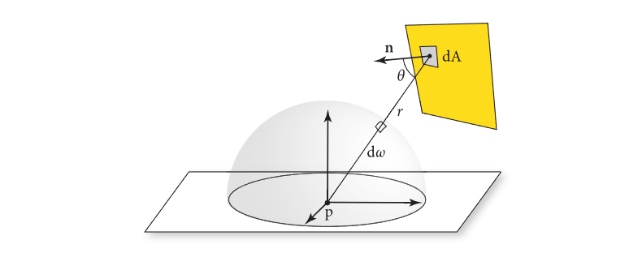
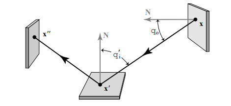

这篇文章我们会从渲染方程开始推导路径积分，当然我们这里指的路径积分不是物理学中由 理查德·费曼 提出来的路径积分，而是由图形学领域的 [Eric Veach][^1] 提出来的。

由于路径积分定义在测度这个概念下，所以我们的文章会用到这个概念，其实不是很难不要害怕。

看这篇文章的前提条件是你熟悉渲染方程、对测度论最好有简单的了解（不了解其实也没关系，我认为问题不大，你只需要知道测度是一种度量集合的一种量（“长度”）就行了）。

我们在 [路径积分](#路径积分-the-path-integral) 前所讲的内容都是为了最后路径积分这一节所铺垫的前置知识。

## 渲染方程与测度变换
### 渲染方程 (The Rendering Equation)
我们熟悉的 **渲染方程** (The Rendering Equation) 长下面这个样子。
$$
\begin{equation}
L_o(\mathbf{x}, \omega_o) = L_e(\mathbf{x}, \omega_o) + \int_{S^2} f_s(\mathbf{x}, \omega_i, \omega_o) L_i(\mathbf{x}, \omega_i) (\omega_i \cdot \mathbf{n}) \, d\omega_i
\end{equation}
$$

它定义在单位球空间 $S^2$ 上，并对立体角 $\omega$ 进行积分。

我们需要将其从单位球面空间 $S^2$ 变换到几何表面空间（任意的三维流形）$\mathcal{M} \subset \mathbb{R}^3$ 上，$\mathbb{R}^3$ 是三维欧几里得空间，其中任意 $\mathbf{x} \in \mathcal{M}$ 一个点是一个三维向量。（我们做的这件事，在 Games 101 中讲 Path Tracing 时，对光源采样有提到。）

如下图 (Fig.1.)：

> 需要注意的是下图所示的 半球空间 $\mathcal{H}$ 是 $S^2$ 的真子集。

 

- 黄色几何表面 $M_0$ 是 $\mathcal{M}$ 的子集 $M_0 \subset \mathcal{M}$.    
- $\mathbf{x}^{\prime}$ 是 黄色表面上的某个点 $\mathbf{x}^{\prime} \in M_0$ .   
- 点 $\mathbf{p}$ 是我们的着色点，我们令渲染方程中的 $\mathbf{x} = \mathbf{p}$ 。则 $\omega_i $ 是在方向 $\mathbf{x}^{\prime} - p$ 上的单位向量（方向），两点间的距离记为 $r = \| \mathbf{x}^{\prime} - p \|$。
- $dA$ 表示点 $\mathbf{x}^{\prime}$ 处微元面 $U \subset M_0$ 的面积（测度），$A$ 是定义在集合 $M_0$ 上的面积 Lebesgue 测度，记作 $A(U)$.  
- 由于图中的 $\mathbf{n}$ 和我们的方程中的 $\mathbf{n}$ 冲突了，所以我们将图中的 $\mathbf{n}$ 记为 $\mathbf{n}^{\prime}$，为点 $\mathbf{x}^{\prime}$ 处的法线。
- 方程中的 $\mathbf{n}$ 为点 $p$ 处的法线。     
- $\theta = \arccos(\mathbf{n}^{\prime} \cdot (-\omega_i))$.

我们改写一下渲染方程。
$$
\begin{equation}
L_o(\mathbf{x}, \omega_o) = L_e(\mathbf{x}, \omega_o) + \int_{S^2} f_s(\mathbf{x}, \omega_i, \omega_o) L_i(\mathbf{x}, \omega_i) (\omega_i \cdot \mathbf{n}) \, d\sigma(\omega_i)
\end{equation}
$$
因为渲染方程中的符号其实有点混用：在积分内部，也就是被积函数中的 $\omega$ 代表方向，而微分中的 $\omega$ 却表示立体角。为了让方程变得更清晰所以我们改写这个方程，把 $d\omega_i$ 改成 $d\sigma(\omega_i)$ 表示在 $S^2$ 中的 $\omega_i$ 方向附近的无穷小邻域的测度。呃..简单说就是微分立体角，和原来你学的是同一个东西，只是更规范。

> 为什么 Artichoke 强调邻域，因为测度是对集合而言的，我们不能说对一个元素的测度，而通常为了方便我们会写 $d\mu(x)$ 这种东西，表示在某个集合中的元素 $x$ 附近的微小邻域下的 $\mu$ 测度。

由于我们的目标和出射方向关系不大，所以我们直接忽视 $\omega_o$。

对上面这么多只是在解释一些符号，提前让你熟悉一下我们接下来推导时所需的测度、空间等等这些符号。

### 测度变换
我们都知道，在一个半径为 $r$ 的球面上存在某个区域的面积为 $S$，则对应的立体角 $\omega$ 为： 
$$
\begin{equation}
\omega = \frac{S}{r^2}
\end{equation}
$$
若是单位立体角，即定义在单位球上的立体角，则直接等于区域面积 $S$。

现在我们要将积分从 $S^2$ 变换到 $\mathcal{M}$ 上，那么我们就需要找到他们的关系，我们可以把几何表面投影到单位球面上就像上图 (Fig.1.) 所示。在微积分中我们都知道，一个微元面可以近似平面。所以就是将平面投影到另一个平面上的问题。即将 $dA(x^{\prime})$ 变换到  $d\sigma(\omega_i)$ （测度变换）。

根据我们上面定义好的一堆符号，我们知道:
$$
r = \| \mathbf{x}^{\prime} - p \|, \quad \omega_i  = \frac{\mathbf{x}^{\prime} - p}{r}
$$
把表面微元 $dA(\mathbf{x}^{\prime})$ 投影到以 $p$ 为球心、$r$ 为半径的球面上。投影面积为：
$$
dA_{proj} =  \cos \theta \cdot dA(\mathbf{x}^{\prime})
$$

根据我们的立体角的定义（公式 3），半径为 $r$ 球面上面积为 $dA_{proj}$ 的立体角为：
$$
d\sigma(\omega_i) = \frac{\cos \theta}{r^2} dA(\mathbf{x}^{\prime})
$$

所以我们得到了从 $\mathcal{M}$ 与 $S^2$ 之间的测度变换关系：
$$
\begin{equation}
d\sigma(\omega) = \frac{\cos \theta}{r^2} dA(\mathbf{x})
\end{equation}
$$

我们就其带入公式 (2) 并引入 visibility 项有：
$$
L_o(\mathbf{x}, \omega_o) = L_e(\mathbf{x}, \omega_o) + \int_{\mathcal{M}} f_s(\mathbf{x}, \omega_i, \omega_o) L_i(\mathbf{x}, \omega_i) V(\mathbf{x},\mathbf{x}') \frac{(\mathbf{n}' \cdot (-\omega_i))\cdot (\mathbf{n} \cdot \omega_i) }{\|\mathbf{x}' - \mathbf{x}\|^2} dA(\mathbf{x}')
$$
我们令
$$
G(\mathbf{x},\mathbf{x}') = V(\mathbf{x},\mathbf{x}') \frac{(\mathbf{n}' \cdot (-\omega_i))\cdot (\mathbf{n} \cdot \omega_i) }{\|\mathbf{x}' - \mathbf{x}\|^2}
$$
其中
$$
V(\mathbf{x}, \mathbf{x}') = \begin{cases} 1, & \text{若点 } \mathbf{x} \text{ 与 } \mathbf{x}' \text{ 之间无任何几何体遮挡} \\  0, & \text{若点 } \mathbf{x} \text{ 与 } \mathbf{x}' \text{ 之间存在遮挡物} \end{cases}
$$
如果我们令 $(\mathbf{x},\mathbf{x}')$ 是一条从点 $\mathbf{x}$ 到 点 $\mathbf{x}'$ 的一条在 $\mathbb{R}^3$ 中的路径 (通俗的说就是线段)，则 $V(\mathbf{x},\mathbf{x}')$ 还能简短的写成。
$$ 
V(\mathbf{x},\mathbf{x}') = \mathbf{1}_{\Phi}(\alpha)
$$
其中 $\mathbf{1}_{\Phi}(\alpha)$ 是集合 $\Phi = \{ \alpha: (\mathbf{x},\mathbf{x}') \cap \mathcal{M} = \emptyset \}$ 的指示函数/示性函数。

由于被积函数中的 $L_i$ 和 $L_o$ 还是不同的函数符号，这在数学上其实并不能说是递归，为了将他们统一起来，我们可以引入光线投射函数 $\mathbf{x}_{\mathcal{M}(\mathbf{x},\omega)}$ ，它返回从 $\mathbf{x}$ 处沿方向 $\omega$ 在 $\mathcal{M}$ 上的第一个可见点。所以我们可以表示：
$$
L_i(\mathbf{x},\omega) = L_o(\mathbf{x}_{\mathcal{M}}(\mathbf{x},\omega),-\omega)
$$

所以最后我们的方程能写成：
$$
\begin{equation}
L_o(\mathbf{x}, \omega_o) = L_e(\mathbf{x}, \omega_o) + \int_{\mathcal{M}} f_s(\mathbf{x}, \omega_i, \omega_o) L_o(x_{\mathcal{M}}(\mathbf{x},\omega_i),-\omega_i) G(\mathbf{x},\mathbf{x}') dA(\mathbf{x}')
\end{equation}
$$

公式 (5) 被称为 **光传输方程** (The Light Transport Equation)。

## 路径的表示
### 三点式光传输方程
在路径积分中我们看不到任何的 $\omega$ 符号，而是用点之间的关系表示。所以在这一节中，我们将消去方程中的方向变量 $\omega$ ，用 $\mathbf{x} \to \mathbf{x}'$ 表示方向。

若 $\omega$ 表示方向 $\mathbf{x}' - \mathbf{x}$，其中 $\mathbf{x},\mathbf{x}' \in \mathcal{M}$ 是场景曲面上的点（三维空间中的向量），则我们定义：

$$
L(\mathbf{x} \to \mathbf{x}') = L(\mathbf{x},\omega)
$$

类似的我们可以把 BSDF 写成如下形式：
$$
f_s(\mathbf{x} \to \mathbf{x}' \to \mathbf{x}'') = f_s(\mathbf{x}',w_i,w_o)
$$
其中 $\omega_i = \mathbf{x} - \mathbf{x}'$, $\omega_o = \mathbf{x}'' - \mathbf{x}'$。

现在，光传输方程的三点形式可以写为:
$$
\begin{equation}
L(\mathbf{x}' \to \mathbf{x}'') = L_e(\mathbf{x}' \to \mathbf{x}'') + \int_{\mathcal{M}} f_s(\mathbf{x} \to \mathbf{x}' \to \mathbf{x}'') L(\mathbf{x} \to \mathbf{x}') G(\mathbf{x} \leftrightarrow \mathbf{x}') dA(\mathbf{x})
\end{equation}
$$

 

### 路径空间
对于长度为 $k$ 的路径 $\bar{x}$ 我们表示成:
$$
\bar{x} = (\mathbf{x}_0,\mathbf{x}_1,\dots,\mathbf{x}_k) = \mathbf{x}_0\mathbf{x}_1 \dots \mathbf{x}_k
$$
其中 $1 \leq k \leq \infty, \quad \mathbf{x}_i \in \mathcal{M}$，$\bar{x}$ 称为传输路径，或者简称路径。

对于所有可能的长度为 $k$ 的传输路径组成的集合我们记作 $\Omega_k$ 称作长度为 $k$ 的路径空间。对于所有长度的路径空间的并集 $\Omega$ 我们称作路径空间。
$$
\Omega = \bigcup_{k=1}^{\infty} \Omega_k
$$
具体的，对于长度为 $k$ 的路径空间，是 $k+1$ 重 $\mathcal{M}$ 的笛卡尔积：
$$
\begin{equation}
\Omega_k = \prod_{i = 0}^{k} \mathcal{M}
\end{equation}
$$
这里连乘号表示笛卡尔积。

### 路径空间的测度
这里补充一点数学前提，对于分别定义在集合 $A$, $B$ 上的 Lebesgue 测度 $\mu$,$\nu$，$m$ 为定义在 $A$ 与 $B$ 的笛卡尔积上的 Lebesgue 测度，它们的关系是: 
$$
\begin{equation}
m(A \times B) = \mu(A) \cdot \nu(B)
\end{equation}
$$

对于路径长度为 $k$ 的路径空间，我们称其上的测度为面积乘积测度，由公式 (7) 和公式 (8) 我们可以给出：
$$
\mu_k(\Omega_k) = \prod_{i = 0}^{k} A(\mathcal{M})
$$
或者我们还可以写成:
$$
\begin{equation}
d\mu_k(\mathbf{x}_0 \dots \mathbf{x}_k) = dA(\mathbf{x}_0) \dots dA(\mathbf{x}_k)
\end{equation}
$$
对于我们感兴趣的路径集合 $D \subset \Omega_k$，我们可以这么计算其测度:
$$
\mu_k(D) = \int_D dA(\mathbf{x}_0) \dots dA(\mathbf{x}_k)
$$

## 测量方程 (The Measurement Equation)
光传输方程能让我们计算场景中所有位置的 Radiance，而通常我们不需要计算场景中所有位置的 Radiance，对于实际应用来说我们只关心场景中相机传感器上的 Radiance，或者说是我们只关心最终图像的像素值。

光传输的目标是计算一组实值测量值 $I_1, \dots I_M$，在直接计算图像的光传输算法中，每个测量值 $I_j$ 表示单个像素的值，而 $M$ 是图像中的像素数。每个测量值对应于相机传感器的输出，该传感器对入射到其上的 Radiance 做出响应。并且其结果受光线击中传感器的 位置 $\mathbf{x}$ 和 方向 $\omega$ 影响，这由传感器的响应度 $W_e(\mathbf{x},\omega)$ 决定。

[Eric Veach][^1] 在其博士论文中给出了其具体方程：
$$
I = \int_{\mathcal{M} \times S^2} W_e(\mathbf{x},\omega)L_i(\mathbf{x},\omega)dAd\sigma^{\perp}_{\mathbf{x}}(\omega)
$$

通常不同位置的点具有不同的 $W_e$.

我们将其写为 $\mathbf{x} \to \mathbf{x}'$ 的形式，并将其用与 [渲染方程与测度变换](#渲染方程与测度变换) 中一样的方式将 $S^2$ 变换到 $\mathcal{M}$ 空间。
$$
\begin{equation}
I_j = \int_{\mathcal{M} \times \mathcal{M}} W_e^{(j)}(\mathbf{x} \to \mathbf{x}') L(\mathbf{x} \to \mathbf{x}') G(\mathbf{x} \leftrightarrow \mathbf{x}') \, dA(\mathbf{x}) \, dA(\mathbf{x}')
\end{equation}
$$
在 [Eric Veach][^1] 中规定 $W_e^{(j)}(\mathbf{x} \to \mathbf{x}')$ 表示方向从 $\mathbf{x}'$ 到 $\mathbf{x}$，即 $\omega$ 是 $\mathbf{x} - \mathbf{x}'$ 的单位向量。

公式 (9) 就叫做 **测量方程** (The Measurement Equation)。

## 路径积分 (The Path Integral)
渲染方程一次只能局部描述来自一个表面的散射，这导致光传输算法必须通过递归来逐步构建路径。而 [Eric Veach][^1] 在其博士论文极具贡献性的提出了**路径积分**（The Path Integral)。路径积分和传统的方程不同，它不是递归定义的，而是一个显式的积分，它可以直接计算从光源出发多条光路经过场景的多次反弹，最后这些光路到相机传感器的某个像素的测量值，它把整条光路看成一个整体。

对于某个测量值 $I_j$ 表示成路径积分：
$$
\begin{equation}
I_j = \int_{\Omega} f_j(\bar{x})d\mu(\bar{x})
\end{equation}
$$
其中 $\Omega$ 是所有长度的传输路径的集合，也就是我们上面提到的 [路径空间](#路径空间)，$\mu$ 为路径空间的测度，$\bar{x}$ 为某个传输路径，$f_j$ 被称为测量贡献函数。

$$
\begin{equation}
\begin{aligned}
f(\bar{x}) &= L_e(\mathbf{x}_0 \to \mathbf{x}_1) G(\mathbf{x}_0 \leftrightarrow \mathbf{x}_1) \\
&\quad ( \prod_{i=1}^{k-1} f_s(\mathbf{x}_{i-1}\to \mathbf{x}_i \to \mathbf{x}_{i+1}) G(\mathbf{x}_i \leftrightarrow \mathbf{x}_{i+1}) ) W_e(\mathbf{x}_{k-1} \to \mathbf{x}_k)
\end{aligned}
\end{equation}
$$

在本节，我们将利用我们上面学过的知识逐步推导出 公式 (12)，并最终写出路径积分。

### 推导
其实非常简单，我们观察一下公式 (6)、公式 (10)。我们可以将公式 (6) 带入 公式 (10) 然后重复递归展开归纳就能得到结果了。

令 $\mathbf{x}_0$ 为光源上某点，$\mathbf{x}_{i} \, \text{where} \, i \in \{i: i \cap \mathbb{Z}\wedge 0 < 1 <k \}$ 为场景中某点，$\mathbf{x}_k$ 为向相机的某点。公式 (10) 可以写成：
$$
\begin{equation}
I_j =\int_{\mathcal{M}^2}W_e^{(j)}(\mathbf{x}_{k-1}\to\mathbf{x}_k)L(\mathbf{x}_{k-1}\to\mathbf{x}_k )G(\mathbf{x}_{k-1}\leftrightarrow\mathbf{x}_k)dA(\mathbf{x}_{k-1})dA(\mathbf{x}_k)
\end{equation}
$$
同理我们可以把公式 (6) 写为:
$$
\begin{equation}
\begin{aligned}
L(\mathbf{x}_{k-1}\to\mathbf{x}_k)
={}&L_e(\mathbf{x}_{k-1}\to\mathbf{x}_k)\\
& +\int_{\mathcal{M}}f_s(\mathbf{x}_{k-2}\to\mathbf{x}_{k-1}\to\mathbf{x}_k)L(\mathbf{x}_{k-2}\to\mathbf{x}_{k-1})G(\mathbf{x}_{k-2}\leftrightarrow\mathbf{x}_{k-1})
dA(\mathbf{x}_{k-2})
\end{aligned}
\end{equation}
$$

我们把 公式 (14) 带入 公式 (13) 有：
$$
\begin{equation}
\begin{aligned}
I_j
={}&
\int_{\mathcal{M}^2}
W_e^{(j)}(\mathbf{x}_{k-1}\to\mathbf{x}_k)
L_e(\mathbf{x}_{k-1}\to\mathbf{x}_k)
G(\mathbf{x}_{k-1}\leftrightarrow\mathbf{x}_k)
dA(\mathbf{x}_{k-1})dA(\mathbf{x}_k)
\\[6pt]
&+
\int_{\mathcal{M}^3}
W_e^{(j)}(\mathbf{x}_{k-1}\to\mathbf{x}_k)
f_s(\mathbf{x}_{k-2}\to\mathbf{x}_{k-1}\to\mathbf{x}_k)
L(\mathbf{x}_{k-2}\to\mathbf{x}_{k-1})
\\
&\qquad\qquad\cdot
G(\mathbf{x}_{k-2}\leftrightarrow\mathbf{x}_{k-1})
G(\mathbf{x}_{k-1}\leftrightarrow\mathbf{x}_k)
dA(\mathbf{x}_{k-2})dA(\mathbf{x}_{k-1})dA(\mathbf{x}_k)
\end{aligned}
\end{equation}
$$
我们可以继续将 公式 (14) 中的 $k$ 都 $-1$ （如果 $k-1 \ge 0$）并带入 公式 (15) , 并不断这样做下去，直到 $k = 0$ 。但通常我们不会这么笨蛋，我们观察一下公式 (15) 发现每继续展开一次，就会多出一个路径顶点，同时增加一项 BSDF 和一项几何项。所以根据这样的规律我们就能得到 公式 (12)。

对长度为 $k$ 的所有路径积分，可以得到:
$$
I_j^{(k)} =\int_{\Omega_k}f_j(\bar{x})\,d\mu_k(\bar{x})
$$

其中，路径 $\bar{x}$ 具有 $k+1$ 个顶点，因此

$$
\Omega_k=\mathcal{M}^{k+1},
\qquad
d\mu_k(\bar{x})=\prod_{i=0}^{k}dA(\mathbf{x}_i)
$$

将所有路径长度的贡献相加，就得到：  
$$
I_j =\sum_{k=1}^{\infty}\int_{\Omega_k}f_j(\bar{x})\,d\mu_k(\bar{x})
$$

最后，将不同长度的路径空间合并：
$$
\Omega = \bigcup_{k=1}^{\infty} \Omega_k
$$

最后的最后令路径空间 $\Omega$ 上的测度 $\mu$ 在每个 $\Omega_k$ 上对应于 $\mu_k$，即可到路径积分：
$$
I_j=\int_{\Omega}f_j(\bar{x})\,d\mu(\bar{x})
$$

下次再见吧! .>_^.
[^1]:[Eric Veach](https://graphics.stanford.edu/papers/veach_thesis/thesis.pdf)
